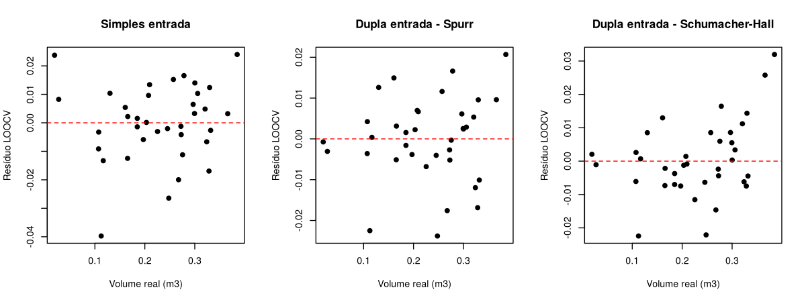
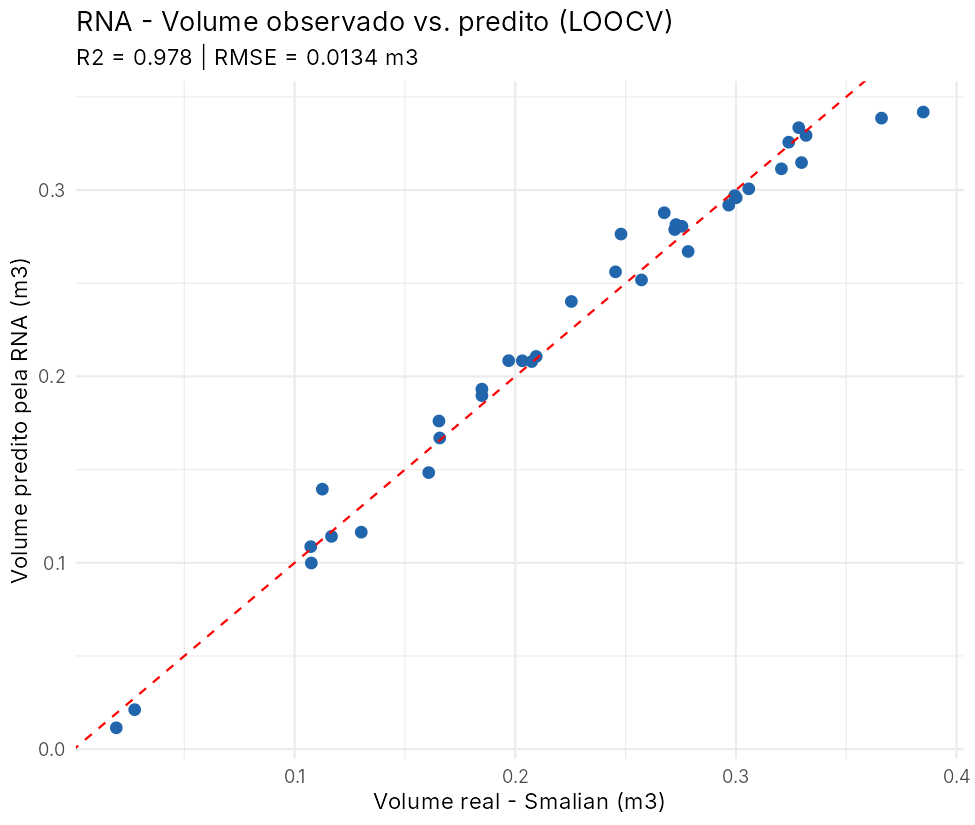

<div align="center">

# 🌲 Desafio 04 — Volume reduzido e equações de volume

**Volume de toras, equações de volume, tabela de volume e rede neural artificial**

   

*Disciplina Mensuração Florestal · Programa de Pós-Graduação em Ciências Florestais · ICA/UFMG*

</div>

## 📋 Objetivo

**Parte A:** comparar o volume reduzido de toras (Francon/Hoppus) com o volume geométrico (Huber) e o volume real (Smalian). **Parte B:** ajustar equações de volume de simples e dupla entrada, gerar a tabela de volume e aplicá-las ao inventário, comparando com uma rede neural artificial (RNA).

## 🗂️ Dados

- [`dados/cubagem.csv`](dados/cubagem.csv): 36 árvores cubadas do talhão 8.
- [`dados/inventario.csv`](dados/inventario.csv): 215 árvores do inventário (alturas não medidas completadas pela relação hipsométrica do [Desafio 02](https://github.com/danieldias936-cyber/desafio-02-altura)).

## 🔧 Métodos

- Toreamento a partir de 0,30 m em toras de 2,00 m; volume Francon/Hoppus, Huber e Smalian por árvore.
- Equações de volume ajustadas com validação cruzada *leave-one-out* (LOOCV): simples entrada (DAP²), Spurr (DAP² × HT) e Schumacher-Hall (logarítmica, com correção de Meyer).
- RNA com uma camada oculta de 3 neurônios (`nnet`), entradas padronizadas e *weight decay* de 0,01, também validada por LOOCV.

## 📈 Principais resultados

| Modelo | R² (LOOCV) | RMSE (LOOCV) |
|---|:-:|:-:|
| Simples entrada (DAP²) | 0,978 | 5,79% |
| **Spurr (DAP² × HT)** | **0,987** | **4,43%** |
| Schumacher-Hall | 0,985 | 4,89% |
| RNA (3 neurônios) | 0,978 | 5,87% |

**Equação selecionada (Spurr):** V = 0,004096 + 3,6298 × 10⁻⁵ · DAP² · HT

- O volume Francon/Hoppus equivale a π/4 ≈ 0,785 do volume geométrico e, em média, a cerca de 76% do volume real.
- Com apenas 36 árvores de calibração, a RNA não superou as equações de dupla entrada.
- Volume do talhão estimado pela RNA: **211,3 m³/ha** e **10.290,5 m³** em 48,7 ha.

<p align="center">
  <br>
  <sub><b>Resíduos das equações de volume</b></sub>
</p>

<p align="center">
  <br>
  <sub><b>RNA: volume observado × predito (LOOCV)</b></sub>
</p>

## 📁 Estrutura do repositório

```text
desafio-04-volume-reduzido-e-tabela/
├── dados/
│   ├── cubagem.csv
│   └── inventario.csv
├── scripts/
│   ├── main.R                         # executa as partes A e B
│   ├── 00_funcoes_comuns.R
│   ├── 01_relacao_hipsometrica.R
│   ├── 02_cubagem_smalian.R
│   ├── 03_parteA_volume_reduzido.R
│   ├── 04_parteB_tabela_volume.R
│   └── 05_rna_volume.R                # rede neural artificial
├── resultados/
│   ├── tabelas/                       # equações, tabela de volume, volumes por árvore
│   └── figuras/
└── docs/
    ├── enunciado.pdf
    └── rna_detalhes.md
```

## ▶️ Como executar

A partir da raiz do repositório:

```r
install.packages(c("readxl", "dplyr", "ggplot2", "nnet"))
```

```bash
Rscript scripts/main.R          # partes A e B
Rscript scripts/05_rna_volume.R # rede neural
```

## 📄 Documentos

- 📝 [Enunciado](docs/enunciado.pdf)
- 🧠 [Detalhes da rede neural](docs/rna_detalhes.md)

## 🧭 Série de desafios

| # | Desafio | |
|:-:|---|:-:|
| 01 | [Diâmetro](https://github.com/danieldias936-cyber/desafio-01-diametro) | |
| 02 | [Altura e relação hipsométrica](https://github.com/danieldias936-cyber/desafio-02-altura) | |
| 03 | [Volume e forma](https://github.com/danieldias936-cyber/desafio-03-volume-e-forma) | |
| **04** | **Volume reduzido e equações de volume** | 📍 você está aqui |
| 05 | [Taper e sortimento](https://github.com/danieldias936-cyber/desafio-05-taper-e-sortimento) | |
| 06 | [Amostragem de Bitterlich](https://github.com/danieldias936-cyber/desafio-06-bitterlich) | |
| 07 | Classificação de sítios florestais | ⏳ |
| 08 | [Validação do índice de sítio](https://github.com/danieldias936-cyber/desafio-08-validacao-sitio) | |
| 09 | [Crescimento e produção (Clutter)](https://github.com/danieldias936-cyber/desafio-09-modelo-clutter) | |

## 👤 Autor

**Daniel Dias** · [@danieldias936-cyber](https://github.com/danieldias936-cyber)  
Mestrado em Ciências Florestais — ICA/UFMG, Montes Claros (MG)
